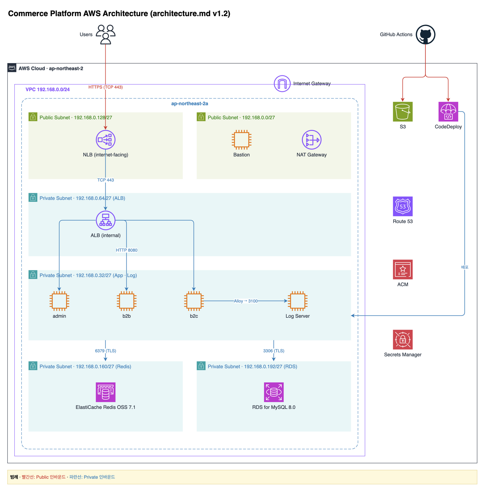

# commerce-infra-claude-tobe

Spring Boot 기반 의류 커머스 플랫폼(admin, b2b, b2c)을 위한 AWS 인프라를 Terraform으로 구성한 프로젝트입니다.

- 애플리케이션 MVP 검증용 **단기 운영 인프라**입니다. 장기 운영이나 대규모 트래픽 처리를 목표로 하지 않습니다.
- dev, staging 없이 **prod 단일 환경**만 구성합니다.
- 상세 요구사항, 설계, 명세는 [`docs/`](docs/)의 기준 문서를 참고하세요.


## 1. 아키텍처



```
Users → NLB (EIP, TCP 443) → ALB (TLS 종료, Host 기반 라우팅) → EC2 (admin / b2b / b2c, :8080)
```

- 앱 서버는 RDS for MySQL과 ElastiCache Redis에 TLS로 접속합니다.
- 각 앱 서버의 Grafana Alloy가 로그 서버(Loki, Grafana)로 로그를 보냅니다.
- 관리자는 Bastion을 경유해서만 내부 리소스에 접근합니다.
- 상세 설계와 선택 근거: [`docs/architecture.md`](docs/architecture.md)


## 2. 문서 구성과 작업 방식

| 문서 | 역할 |
|---|---|
| [`docs/context.md`](docs/context.md) | 요구사항, 기술 스택, 제약 조건 |
| [`docs/architecture.md`](docs/architecture.md) | 확정 아키텍처와 설계 근거 |
| [`docs/infrastructure-spec.md`](docs/infrastructure-spec.md) | Terraform 구현의 유일한 기준 명세 (Source of Truth) |
| [`docs/ai-decision.md`](docs/ai-decision.md) | 엔지니어 의사결정과 위험 수용 이력 |
| [`docs/reviews/`](docs/reviews/) | PM, Security, SRE AI 관점 별 설계 리뷰 결과 |

### 작업 흐름
이 프로젝트는 **엔지니어가 설계와 최종 결정을 맡고, AI(Claude Code)가 리뷰와 구현을 지원**하는 방식으로 진행했습니다. 역할 분담은 [CLAUDE.md](CLAUDE.md)에 정의되어 있습니다.

1. **요구사항 정의**: 엔지니어가 context.md에 요구사항을 작성했습니다.
2. **초기 설계**: 엔지니어가 1차적으로 인프라 설계를 하고 architecture.md 초안과 다이어그램을 작성했습니다.
3. **AI 설계 리뷰**: AWS PM, 보안, SRE 관점의 리뷰어 3명이 각자 독립적으로 검토했습니다.
   - [`R1`](docs/reviews/R1-20261113-review-summary.md): 발견 사항 23건
   - [`R2`](docs/reviews/R2-20261113-review-summary.md): 발견 사항 17건
4. **엔지니어 결정**: 리뷰 항목마다 수용, 수정, 기각, 위험 수용 중 하나로 결정했습니다. 결정은 ai-decision.md에 D-xxx로 기록했습니다.
5. **아키텍처 승인**: context.md와 architecture.md를 승인했습니다.
6. **상세 명세 작성과 승인**: AI가 infrastructure-spec.md 초안을 쓰면서 결정되지 않은 값을 `미확정(U-xx)`으로 표시했습니다. 엔지니어가 이 값을 모두 정한 뒤 명세를 승인했습니다.
7. **Terraform 구현**: 승인된 명세만을 기준으로 구현했습니다. 이후 정적 검증, plan 검토, 엔지니어 승인을 거쳐 apply했습니다.

원칙은 다음과 같습니다.
- AI의 제안은 승인된 결정이 아닙니다.
- 명세에 없거나 결정되지 않은 값을 AI가 임의로 정하지 않습니다.


## 3. 기술 스택과 버전

| 항목 | 값 |
|---|---|
| Terraform | 1.17.2 |
| AWS Provider | hashicorp/aws 6.71.0 |
| Region | ap-northeast-2 (서울) |
| State | Local State (`terraform/terraform.tfstate`) |
| 애플리케이션 | JDK 17, Spring Boot 3.4.0, Ubuntu 24.04 LTS, JAR 실행 |
| 데이터 | RDS for MySQL 8.0, ElastiCache Redis OSS 7.1 |
| 로그·모니터링 | Grafana Alloy, Grafana Loki, Grafana |
| CI/CD | GitHub Actions, S3, CodeDeploy |


## 4. 디렉터리 구조

```
.
├── CLAUDE.md               # 프로젝트 작업 규칙 (엔지니어와 AI의 역할)
├── README.md
├── docs/                   # 요구사항, 아키텍처, 명세, 결정 이력, 리뷰
│   └── reviews/
├── images/                 # 아키텍처 다이어그램
└── terraform/
    ├── versions.tf         # Terraform, Provider 버전
    ├── providers.tf        # region, default_tags
    ├── locals.tf           # 명세 기준 값
    ├── main.tf             # Child Module 호출과 모듈 간 연결
    ├── outputs.tf          # 수동 작업에 필요한 출력값
    └── modules/
        ├── network/          # VPC, Subnet, IGW, NAT Gateway, Route Table
        ├── security_group/   # Security Group 1개와 ingress·egress 규칙 (7회 호출)
        ├── ec2_instance/     # EC2 1대, IMDSv2, root volume 암호화 (5회 호출)
        ├── nlb/              # NLB, EIP, TCP Listener, ALB 대상 Target Group
        ├── alb/              # internal ALB
        ├── dns_certificate/  # Route 53 Public Hosted Zone, ACM 인증서
        ├── rds/              # DB Subnet Group, Parameter Group, RDS for MySQL
        ├── elasticache/      # Subnet Group, Redis Replication Group
        └── cicd/             # 배포 아티팩트 S3 Bucket, CodeDeploy Application
```


## 5. 관리 범위

### Terraform이 생성하는 리소스 (69개)
| 구분 | 리소스 |
|---|---|
| Network | VPC, Subnet 8, IGW, NAT Gateway, EIP 2, Route Table 3과 연결 8 |
| Security | Security Group 7, ingress 규칙 12, egress 규칙 5 |
| Load Balancing | NLB, NLB Listener, NLB Target Group, ALB |
| DNS·Certificate | Route 53 Public Hosted Zone, ACM 인증서 |
| Compute | EC2 5대 (admin, b2b, b2c, log, bastion) |
| Data | RDS for MySQL과 Subnet Group·Parameter Group, ElastiCache Redis와 Subnet Group |
| CI/CD | S3 Bucket(versioning, SSE, Public Access Block), CodeDeploy Application |


## 6. 사용 방법

```bash
cd terraform

terraform init
terraform validate
terraform plan -out=tfplan
terraform show tfplan        # 생성·변경·삭제 대상을 검토
terraform apply tfplan       # 검토한 plan 그대로 적용
```

- 엔드포인트, IP, NS, ACM 검증 레코드 같은 생성 결과는 `terraform output`으로 확인합니다.
- `terraform apply`와 `terraform destroy`는 엔지니어 승인 후에만 실행합니다.

### 삭제
```bash
terraform destroy
```

> ⚠️ **destroy하면 데이터를 복구할 수 없습니다.**
> - S3 버킷은 `force_destroy = true`라서 안에 든 아티팩트까지 함께 삭제됩니다.
> - RDS는 자동 백업 보존 기간이 0이고 최종 스냅샷도 만들지 않습니다(`skip_final_snapshot = true`). 삭제 보호도 꺼져 있습니다.
