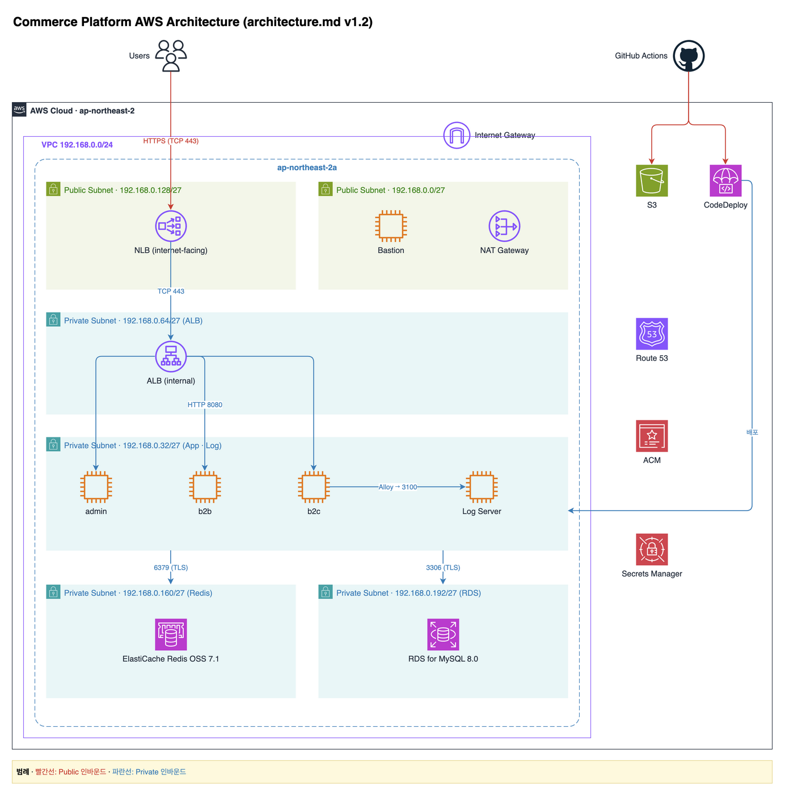

# 1. Architecture

| 항목 | 값 |
|---|---|
| 상태 | Approved |
| 버전 | 1.3 |
| 날짜 | 2026-11-14 |
| 작성자 | 박가온누리 |
| 요구사항 기준 | docs/context.md(v1.0) |

## 1.1 문서 목적
본 문서는 context.md에 정의된 요구사항을 충족하기 위한 AWS 인프라와 선택 근거, 확정 여부를 기록

Terraform 구현을 위한 상세 설정은 아키텍처 승인 후 infrastructure-spec.md에서 별도로 작성

## 1.2 설계 범위
- 네트워크 및 외부 접근
- 애플리케이션 실행 환경
- 데이터베이스 및 캐시
- 애플리케이션 배포 도구
- 로그 수집 및 모니터링
- 보안 및 접근 제어

# 2. 전체 아키텍처

## 2.1 아키텍처 다이어그램
엔지니어가 설계한 아키텍처 다이어그램을 추가한다.

**확정 아키텍처 (v1.0)**

- 빨간선은 Public 인바운드, 파란선은 Private 인바운드 트래픽이다.
- 다이어그램에는 ap-northeast-2c의 ALB Subnet(192.168.0.224/27)과 RDS Subnet(192.168.0.96/27)을 표시하지 않았다. 두 Subnet은 REQ-08 Subnet 표에 따라 구성한다.

## 2.2 요구사항별 아키텍처 결정

### REQ-01. 외부 사용자 서비스 접근
| 채택 인프라 | 선택 근거 | 확정 여부 |
|---|---|---|
| Network Load Balancer | 외부 사용자에게 고정 Public IP를 제공해야 하므로 EIP를 연결할 수 있는 인터넷 진입점으로 채택한다. NLB의 ALB 대상 Target Group을 통해 트래픽을 ALB로 전달한다. | 결정 | 
| Elastic IP | 외부 사용자가 방화벽 허용 목록에 등록할 수 있도록 NLB의 인터넷 진입 IP를 고정한다. | 결정 | 
| Route 53 | Admin, B2B, B2C 도메인을 외부 진입점인 NLB에 연결하기 위해 채택한다. | 결정 | 
| Application Load Balancer | NLB로부터 전달된 HTTPS 연결의 TLS를 종료하고, 요청의 Host 헤더를 기준으로 서비스별 EC2에 트래픽을 전달하기 위해 채택한다. | 결정 | 
| AWS Certificate Manager | ALB HTTPS 리스너에서 사용할 TLS 인증서를 관리하기 위해 채택한다. | 결정 | 

**인프라 설계 시 참고 사항**
- HTTP 요청 차단: NLB에 80 Listener를 두지 않으며, NLB에서 ALB로는 443만 전달한다.
- NLB Subnet의 AZ는 ALB Subnet의 AZ 중 하나와 일치시키며, NLB Cross-Zone Load Balancing은 사용하지 않는다.
- NLB에는 Security Group을 연결하며, NLB Security Group의 인바운드는 0.0.0.0/0으로부터의 443을 허용한다. ALB Security Group의 인바운드는 NLB Security Group으로부터의 443만 허용한다.
- Admin 서비스는 B2B, B2C와 동일하게 별도의 출발지 제한 없이 외부에 공개한다.
- ALB HTTPS Listener의 TLS 인증서는 Terraform으로 ACM에 요청하며, 인증서 범위는 imcommerce.shop과 *.imcommerce.shop으로 한다. ACM DNS 검증 CNAME은 수동으로 등록한다.
- NLB Listener와 NLB의 ALB 대상 Target Group은 TCP 443으로 구성한다.
- ALB HTTPS(443) Listener 생성과 NLB Target Group에 대한 ALB 등록은 ACM 인증서 발급 완료 후 수동으로 진행한다. ALB Host 기반 Listener Rule과 서비스별 Target Group도 수동으로 생성한다.
- ALB HTTPS Listener의 default action은 Forward로 한다. NLB의 ALB 대상 Target Group 헬스 체크는 protocol HTTPS, path /healthz, Success Code 200으로 한다. Client IP 보존은 요구하지 않는다.
- Route 53은 Terraform으로 imcommerce.shop Public Hosted Zone만 생성하며, 그 외 작업(서비스 도메인 Alias 레코드, registrar NS 위임)은 수동으로 진행한다.

### REQ-02. 애플리케이션 실행
| 채택 인프라 | 선택 근거 | 확정 여부 |
|---|---|---|
| EC2 | Admin, B2B, B2C를 각각 별도 서버에서 실행하여 서비스별 독립 배포 요구사항을 충족한다. 기존 Ubuntu 기반 JAR 실행 방식을 유지할 수 있으며, ALB Target Group의 /healthz 헬스 체크로 애플리케이션의 응답 상태를 확인한다. | 결정 | 

**인프라 설계 시 참고 사항**
- 헬스 체크 결과에 대한 장애 알림은 구성하지 않는다.
- EC2에 user_data를 사용하지 않으며, 애플리케이션 서버의 소프트웨어(JDK 17, Grafana Alloy)는 수동으로 설치한다.

### REQ-03. 데이터베이스
| 채택 인프라 | 선택 근거 | 확정 여부 |
|---|---|---|
| Amazon RDS for MySQL | MySQL 8을 지원하는 관리형 데이터베이스를 사용하여 직접 설치 및 운영에 필요한 관리 부담을 줄인다. 외부 인터넷 직접 접근을 제한하고 애플리케이션 서버와 인프라 관리자에게만 접근을 허용하도록 구성한다. | 결정 | 

**인프라 설계 시 참고 사항**
- 데이터 보존 및 복구 방안은 현재 프로젝트의 논의 범위에서 제외한다.
- RDS DB Subnet Group의 2개 AZ 조건을 충족하도록 다른 AZ에 RDS용 Private Subnet을 추가로 확보하며, 192.168.0.96/27을 RDS용 두 번째 Private Subnet으로 사용한다.
- RDS 저장 암호화를 적용하고, RDS 연결에 TLS를 강제한다.
- RDS는 Single-AZ(ap-northeast-2a)로 구성하며, 자동 백업과 최종 스냅샷은 사용하지 않는다.

### REQ-04. 캐시
| 채택 인프라 | 선택 근거 | 확정 여부 |
|---|---|---|
| AWS ElastiCache for Redis | Redis OSS 7을 지원하는 관리형 캐시 서비스를 사용하여 직접 설치 및 운영에 필요한 관리 부담을 줄인다. 외부 인터넷 직접 접근을 제한하고 애플리케이션 서버와 인프라 관리자에게만 접근을 허용하도록 구성한다. | 결정 | 

**인프라 설계 시 참고 사항**
- Redis는 전송 구간 암호화(TLS)를 적용하며, AUTH는 적용하지 않는다.
- ElastiCache는 노드 1개의 replication group으로 구성하고, 저장 암호화를 적용한다.

### REQ-05. CI/CD
| 채택 인프라 | 선택 근거 | 확정 여부 |
|---|---|---|
| GitHub Actions | GitHub에 저장된 애플리케이션 코드를 기반으로 서비스별 빌드 및 배포 작업을 실행 | - | 
| S3 | 빌드된 애플리케이션 배포 아티팩트를 저장하고 CodeDeploy에 전달하기 위해 채택한다. | 결정 | 
| CodeDeploy | EC2에 애플리케이션을 배포하고 서비스별 배포 실행 상태와 성공 및 실패 결과를 확인하기 위해 채택한다. | 결정 | 

**인프라 설계 시 참고 사항**
- Github Actions는 AWS 외부에서 사용하기 때문에 인프라 배포 범위에서 제외한다.
- 배포 성공 판정: appspec의 ValidateService 단계에서 localhost:8080/healthz를 재시도하며 확인하고, 실패하면 non-zero로 종료한다.
- CodeDeploy Agent는 인프라 구축 완료 후 애플리케이션 서버에 수동으로 설치한다.
- Terraform은 CodeDeploy Application까지만 생성하며, Deployment Group은 수동으로 구성한다. CodeDeploy Application은 3개 서비스가 공용으로 사용하는 1개로 한다.
- 배포 아티팩트 S3 버킷은 versioning과 서버 측 암호화(SSE-S3)를 적용하며, Public Access Block은 적용하지 않는다.

### REQ-06. 로그 및 모니터링
| 채택 인프라 | 선택 근거 | 확정 여부 |
|---|---|---|
| EC2 | 애플리케이션 서버에 Grafana Alloy를 설치하여 로그를 수집하고, 별도 로그 모니터링 EC2에서 Loki와 Grafana를 운영한다. 기존 로그 필터링 및 시각화 구성을 유지하고 커스터마이징하기 위해 채택한다.  | 결정 | 

**인프라 설계 시 참고 사항**
- 서비스별 로그 구분 조회는 각 애플리케이션 서버의 Alloy에 서버별 정적 label(예: service=admin)을 부여하여 구분하며, 해당 설정은 수동으로 진행한다.
- 로그 모니터링 EC2는 애플리케이션 서버와 같은 Private Subnet에 배치한다. Grafana는 Bastion을 경유한 접근(예: SSH 터널)만 허용한다. Grafana 초기 관리자 비밀번호는 기본값(admin)을 유지한다.
- 로그 모니터링 서버의 EBS 크기는 20GiB(root volume)로 한다. Loki retention은 현재 논의 범위에서 제외한다.
- 로그 모니터링 서버의 Loki와 Grafana는 수동으로 설치한다.

### REQ-07. 보안
| 채택 인프라 | 선택 근거 | 확정 여부 |
|---|---|---|
| Security Group | 애플리케이션, 데이터베이스, Redis 등 리소스별로 필요한 네트워크 통신만 허용하여 접근을 제한하기 위해 채택한다. 단, 애플리케이션 3대의 서버는 1개의 Security Group에 할당하며, 인바운드는 ALB Security Group으로부터의 8080과 Bastion Security Group으로부터의 22만 허용한다. 로그 모니터링 서버는 별도의 Loki Security Group에 할당하며, 인바운드는 애플리케이션 Security Group으로부터의 3100과 Bastion Security Group으로부터의 22, 3000만 허용한다. Bastion Security Group의 인바운드는 119.192.127.156/32로부터의 22만 허용한다. RDS Security Group은 3306, Redis Security Group은 6379에 대해 애플리케이션 Security Group과 Bastion Security Group으로부터의 인바운드만 허용한다. egress는 NLB Security Group은 ALB Security Group으로의 443만, ALB Security Group은 애플리케이션 Security Group으로의 8080만 허용하고, 애플리케이션·Loki·Bastion Security Group은 0.0.0.0/0 전체 허용, RDS·Redis Security Group은 egress 규칙을 두지 않는다. | 결정 | 
| EC2 | 인프라 관리자가 Bastion 서버를 경유하여 Private Subnet에 위치한 내부 인프라에 접근할 수 있도록 구성한다. | 결정 | 

**인프라 설계 시 참고 사항**
- AWS IAM은 수동으로 구성할 예정이기 때문에 인프라 배포 범위에서 제외한다. EC2, CodeDeploy, S3 인프라 배포 후 다음 항목을 수동으로 구성한다.
- EC2 Instance Profile (S3 아티팩트 읽기, CodeDeploy Agent)
- CodeDeploy Service Role
- GitHub Actions 인증 방식 (OIDC 또는 Access Key)
- 민감 정보 관리 방식은 인프라 배포 완료 후 결정하며 현재 논의 범위에서 제외한다. RDS master password는 manage_master_user_password를 사용하여 Secrets Manager에서 관리한다. 애플리케이션은 master password를 앱 설정에 고정값으로 넣어 사용하며, 인프라를 2일 후 삭제할 예정이므로 Secrets Manager rotation 대응은 적용하지 않는다.
- 모든 EC2는 IMDSv2를 강제한다(metadata_options.http_tokens = "required").
- 모든 EC2의 EBS에 저장 암호화를 적용한다.
- EC2 SSH Key Pair는 AWS에 수동으로 생성된 기존 Key Pair를 이름으로 참조한다. 애플리케이션 서버 3대는 1개의 Key Pair를 공유하고, 로그 모니터링 서버와 Bastion은 각각 별도 Key Pair를 사용한다.
- Bastion은 Public Subnet의 Public IP 자동 할당으로 Public IP를 받는다.

### REQ-08. 네트워크
| 채택 인프라 | 선택 근거 | 확정 여부 |
|---|---|---|
| Amazon VPC / Subnet | Bastion, NLB, NAT Gateway 등 인터넷 연결이 필요한 리소스는 Public Subnet에 배치하고, 애플리케이션 서버, 로그 모니터링 서버, 데이터베이스, Redis, ALB는 Private Subnet에 배치하여 인터넷 직접 접근 경로와 내부 리소스를 분리한다. | 결정 | 
| NAT Gateway | Private Subnet의 애플리케이션 서버와 로그 모니터링 서버가 필요한 외부 서비스에 아웃바운드 연결을 시작할 수 있도록 채택한다. | 결정 | 
| Internet Gateway | Public Subnet의 인터넷 연결 및 NAT Gateway를 통한 인터넷 아웃바운드 통신 경로를 제공하기 위해 채택한다. | 결정 | 
| Route Table | Public Subnet은 IGW로, 인터넷 아웃바운드가 필요한 Private Subnet은 NAT Gateway로 라우팅하여 네트워크별 통신 경로를 분리한다. | 결정 | 

**인프라 설계 시 참고 사항**
- REQ-08의 "외부와 통신"은 Private Subnet의 서버가 먼저 연결을 시작하는 NAT Gateway 경유 outbound 통신으로 한정한다.
- NAT Gateway 경로는 App Subnet(애플리케이션 서버, 로그 모니터링 서버)에만 둔다. ALB, Redis, RDS Subnet은 local 경로만 있는 별도 Private Route Table에 연결한다.
- Subnet은 가능한 한 모두 ap-northeast-2a에 배치하며, 서로 다른 AZ가 필요한 RDS Subnet(192.168.0.192/27, 192.168.0.96/27)과 ALB Subnet(최소 2개 AZ 필요)을 위해 ap-northeast-2c를 추가로 사용한다.

| Subnet | 용도 | AZ |
|---|---|---|
| 192.168.0.0/27 | Public (Bastion, NAT Gateway) | ap-northeast-2a |
| 192.168.0.128/27 | Public (NLB) | ap-northeast-2a |
| 192.168.0.64/27 | Private (ALB) | ap-northeast-2a |
| 192.168.0.224/27 | Private (ALB) | ap-northeast-2c |
| 192.168.0.32/27 | Private (App, 로그 모니터링 서버) | ap-northeast-2a |
| 192.168.0.160/27 | Private (Redis) | ap-northeast-2a |
| 192.168.0.192/27 | Private (RDS) | ap-northeast-2a |
| 192.168.0.96/27 | Private (RDS) | ap-northeast-2c |

